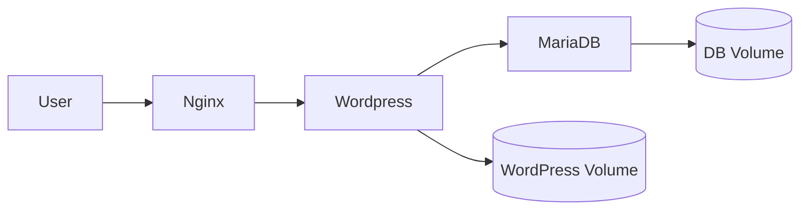

# 42 Inception Rehberi

Bu dosya, Inception projesine en baştan başlaman için hazırlandı. Docker nedir, neden kullanılır, nasıl düşünülür ve 42 Inception’da senden ne beklenir; hepsini öğretici bir sırayla anlatır.

Not: Çalışma alanındaki `en.subject.pdf` dosyası Inception değil, C++ Module 08 içeriği içeriyor. Bu rehber Inception projesi için hazırlanmıştır.

## 1. Inception nedir?

Inception, 42 Common Core içinde kendi küçük altyapını Docker ile kurduğun bir projedir. Amaç tek bir uygulama yazmak değil, bir sistem kurmaktır.

Projede genelde şunları kurarsın:

- `nginx` ters proxy
- `wordpress` uygulaması
- `mariadb` veritabanı
- kalıcı veri için `volume`
- servislerin haberleşmesi için `network`
- güvenlik ve yapılandırma için `Dockerfile`, `docker-compose.yml`, `.env`

Asıl fikir şudur: her servis ayrı bir container içinde çalışır ve birbirine kontrollü şekilde bağlanır.

## 2. Docker nedir?

Docker, uygulamaları ve bağımlılıklarını izole container’lar içinde çalıştırmanı sağlayan bir platformdur.

Basit düşünürsek:

- Image = şablon
- Container = o şablondan çalışan canlı süreç
- Volume = kalıcı veri alanı
- Network = container’ların kendi aralarında konuştuğu ağ

Docker’ın faydası şu:

- aynı ortamı her yerde çalıştırabilirsin,
- “bende çalışıyordu” problemi azalır,
- servisleri birbirinden ayırırsın,
- kurulum adımlarını tekrar tekrar yapmazsın.

## 3. Docker nasıl çalışır?

Docker’ı anlamak için şu katmanları bilmek yeterlidir:

### Image

Bir uygulamanın nasıl kurulacağını tarif eden paket gibidir. İçinde işletim sistemi tabanı, bağımlılıklar ve çalıştırma komutu olabilir.

### Container

Image’ın çalışan örneğidir. Container başlatılır, durdurulur, silinir.

### Dockerfile

Image üretmek için yazdığın tarif dosyasıdır. Örneğin:

- hangi taban image kullanılacak,
- hangi paketler kurulacak,
- hangi dosyalar kopyalanacak,
- container açılınca hangi komut çalışacak.

### docker-compose

Birden çok container’ı tek dosyadan yönetmeni sağlar. Inception için çok önemlidir çünkü nginx, wordpress ve mariadb birlikte çalışır.

### Volume

Container silinse bile veri kalsın diye kullanılır. Veritabanı ve WordPress dosyaları için önemlidir.

### Network

Servislerin güvenli ve düzenli iletişim kurmasını sağlar. Genelde sadece gereken servisler birbirini görür.

## 4. Docker neden kullanılır?

Inception’da Docker kullanmanın sebebi sadece modern görünmek değildir.

- Servisleri izole tutarsın.
- Gerekli bağımlılıkları sistemine kurmak zorunda kalmazsın.
- Her şeyi tekrar üretilebilir yaparsın.
- Evaluation sırasında kurulumun anlaşılır ve temiz olur.

## 5. Docker kurulu mu nasıl anlarsın?

Senin bildiğin `docker ps` komutu tek başına yeterli değil. Şunları da kontrol et:

```bash
docker --version
docker ps
docker images
docker compose version
```

Eğer `docker ps` çalışıyor ama diğerleri çalışmıyorsa, Docker kısmen kurulu olabilir ama eksik yapılandırma da olabilir.

## 6. Docker nasıl kurulur?

Sen Debian kullanıyorsun. En genel kurulum akışı şu şekildedir.

### Debian üzerinde temel kurulum

```bash
sudo apt update
sudo apt install -y ca-certificates curl gnupg
```

Sonra Docker’ın resmi deposunu eklemek gerekir. Debian sürümüne göre adımlar biraz değişebilir. En sağlıklı yol, Docker’ın resmi dökümantasyonunu takip etmektir. Eğer sistemde zaten kuruluysa, yeniden kurmana gerek olmayabilir.

Kurulumdan sonra genelde şunları test edersin:

```bash
docker run hello-world
```

Bu komut bir container indirip çalıştırır. Başarılıysa Docker temel olarak çalışıyor demektir.

### Kullanıcı yetkisi

Her seferinde `sudo docker ...` yazmak istemiyorsan kullanıcıyı `docker` grubuna ekleyebilirsin:

```bash
sudo usermod -aG docker $USER
```

Sonra oturumu kapatıp açman gerekir.

## 7. Docker Compose neden önemli?

Inception’da tek container yetmez. En az birkaç servis birlikte çalışır. Bu yüzden `docker compose` kullanırsın.

Compose sana şunları sağlar:

- servis tanımları
- port eşlemeleri
- volume bağlantıları
- network tanımları
- environment değişkenleri

Tek dosyayla tüm sistemi ayağa kaldırırsın.

## 8. Inception projesinin amacı

Bu projenin amacı şudur:

- tek bir sunucu üzerinde birden fazla servisi Docker ile kurmak,
- bu servisleri güvenli ve tekrar üretilebilir biçimde yönetmek,
- web uygulaması, veritabanı ve reverse proxy mantığını anlamak,
- container izolasyonunu ve veri kalıcılığını öğrenmek.

Evaluation’da senden beklenen, “çalışıyor” demekten fazlasıdır. Şunları açıklayabilmelisin:

- neden nginx var,
- neden doğrudan WordPress’i dışarı açmıyorsun,
- neden volume kullanıyorsun,
- neden ayrı network kullanıyorsun,
- neden her servis kendi container’ında.

## 9. Tipik Inception mimarisi

En basit ve klasik yapı şu şekildedir:



### Nginx

İnternetten gelen istekleri karşılar. Genelde HTTPS’i burada sonlandırırsın ve istekleri WordPress container’ına yönlendirirsin.

### WordPress

Kullanıcının gördüğü web uygulamasıdır. PHP tabanlı çalışır.

### MariaDB

Kullanıcı verilerini, yazıları ve site ayarlarını saklar.

## 10. En baştan çalışma planı

Eğer sıfırdan ilerleyeceksen şu sırayı izle:

### Aşama 1: Ortamı doğrula

- Docker kurulu mu?
- `docker compose` çalışıyor mu?
- Proje klasörün hazır mı?

### Aşama 2: Proje dizinini kur

Beklenen yapı genelde şu mantıktadır:

- `srcs/`
- `requirements/`
- `Makefile`
- `.env`

Senin kendi repo düzenin farklı olabilir ama amaç dosyaları temiz ayırmaktır.

### Aşama 3: Compose planını çiz

Önce hangi servislerin olacağını yaz:

- nginx
- wordpress
- mariadb

Sonra bunların hangi portları açacağını, hangi volume’leri kullanacağını ve hangi network’te olacağını planla.

### Aşama 4: MariaDB ile başla

Veritabanı olmadan WordPress anlamlı çalışmaz. Önce DB container’ını çalıştırmayı hedefle.

Bu aşamada düşünmen gerekenler:

- DB verisi nereye kaydedilecek?
- DB kullanıcı adı ve şifresi nerede tutulacak?
- container yeniden başlarsa veri kaybolacak mı?

### Aşama 5: WordPress’i bağla

WordPress container’ı MariaDB’ye bağlanmalı.

Bu noktada kontrol edeceğin şeyler:

- PHP-FPM çalışıyor mu?
- WordPress dosyaları doğru yerde mi?
- DB bağlantı bilgileri doğru mu?

### Aşama 6: Nginx’i ekle

Nginx dış dünyaya açılan kapıdır.

Kontrol etmen gerekenler:

- 443 portu açık mı?
- HTTPS çalışıyor mu?
- istekler WordPress’e yönleniyor mu?

### Aşama 7: Volume ve network düzeni

Bu aşamada amaç sadece “çalıştırmak” değil, doğru mimari kurmaktır.

- DB için ayrı volume kullan.
- WordPress dosyaları için gerekirse ayrı volume kullan.
- Servisler arasında özel network kullan.
- Gereksiz port açma.

## 11. Öğrenmen gereken komutlar

Sen sadece `docker ps` biliyorum diyorsun. Aşağıdaki komutlar çok işine yarayacak.

### Temel komutlar

```bash
docker ps
docker ps -a
docker images
docker volume ls
docker network ls
docker logs <container>
docker exec -it <container> sh
docker stop <container>
docker rm <container>
docker rmi <image>
```

### Compose komutları

```bash
docker compose up -d
docker compose down
docker compose build
docker compose logs
docker compose ps
```

## 12. Dockerfile mantığı

Her servis için gerekirse kendi Dockerfile’ını yazarsın.

Bir Dockerfile genelde şu mantıkla ilerler:

1. Base image seçilir.
2. Paketler kurulur.
3. Gerekli dosyalar kopyalanır.
4. Konfigürasyon yapılır.
5. Container açılınca çalışacak komut belirlenir.

Inception’da sık görülen örnekler:

- nginx için özel config
- wordpress için PHP-FPM hazırlığı
- mariadb için başlangıç veritabanı ayarı

## 13. .env neden kullanılır?

Çünkü şifreleri ve sabit değerleri doğrudan compose dosyasına gömmek istemezsin.

Örnek değişkenler:

- DB_NAME
- DB_USER
- DB_PASSWORD
- DB_ROOT_PASSWORD
- DOMAIN_NAME

Bu sayede yapılandırma temiz kalır ve değiştirmesi kolay olur.

## 14. Güvenlik mantığı

Inception’da güvenlik gösterimi önemlidir.

Şunları düşün:

- Neden servisleri direkt host’a açmıyorsun?
- Neden sadece gerekli portları publish ediyorsun?
- Neden HTTPS kullanıyorsun?
- Neden secret benzeri değerleri düzgün yönetiyorsun?

Evaluation’da güvenlik kararlarını açıklayabilmen gerekir.

## 15. Kalıcı veri neden önemli?

Container silinirse içindeki geçici veri kaybolabilir. Veritabanı ve site içeriği için bu kabul edilemez.

Bu yüzden volume kullanırsın.

### Volume neyi çözer?

- DB restart sonrası veri kaybını azaltır.
- WordPress içerikleri daha kalıcı olur.
- Sistemi yeniden kurarken veri korunur.

## 16. Evaluation’da ne sorulabilir?

Hazırlıklı olman gereken sorular:

- Docker image ile container arasındaki fark nedir?
- Neden compose kullandın?
- Volume neden gerekli?
- Nginx neden proxy olarak kullanılıyor?
- Servisler neden ayrı container’larda?
- Port 80 yerine neden 443?
- MariaDB verisi nereye yazılıyor?
- WordPress container’ı DB’ye nasıl bağlanıyor?

## 17. Sıfırdan öğrenme planı

Eğer gerçekten en baştan başlıyorsan şu sırayla ilerle:

1. Docker image/container farkını öğren.
2. Temel Docker komutlarını dene.
3. Basit bir container çalıştır.
4. Volume ve network kavramlarını anla.
5. Compose ile iki servisli küçük örnek kur.
6. Sonra Inception mimarisini kur.

## 18. Çalışırken kullanacağın kontrol listesi

- Docker çalışıyor mu?
- `docker compose` çalışıyor mu?
- Container’lar ayağa kalkıyor mu?
- Servisler birbirini görüyor mu?
- Veriler volume’a yazılıyor mu?
- Nginx doğru yönlendiriyor mu?
- WordPress veritabanına bağlanıyor mu?
- HTTPS düzgün çalışıyor mu?

## 19. Sık yapılan hatalar

- Her şeyi tek container’a koymak.
- Volume kullanmamak.
- DB şifrelerini düz metin halinde her yere dağıtmak.
- Nginx’i yanlış yapılandırmak.
- Servislerin birbirine erişim yolunu karıştırmak.
- `docker ps` dışında log ve exec komutlarını kullanmamak.

## 20. Bu projede nasıl düşünmelisin?

Inception bir yazılım projesinden çok bir sistem kurma egzersizi gibidir. Yani düşünce şekli şudur:

- ne çalışıyor?
- neden böyle çalışıyor?
- bir servis bozulursa nerede bakarım?
- veri neden kaybolmuyor?
- istek nereye gidiyor?

Bu sorulara cevap verebiliyorsan projeyi gerçekten anlamışsın demektir.

## 21. Başlamak için en doğru ilk adım

Senin durumda ilk yapman gereken şey Docker’ı yeniden öğrenmek değil, mevcut sisteminin üstüne bilinçli bir harita çıkarmak.

Önce şu üç şeyi netleştir:

1. Docker gerçekten çalışıyor mu?
2. Compose kullanabiliyor musun?
3. Projenin servis mimarisini anladın mı?

Bu üçünü netleştikten sonra Inception kurulumunu adım adım yaparız.

## 22. Kısa özet

Docker, uygulamaları container içinde izole çalıştırmanı sağlar. Inception da bu mantıkla nginx, WordPress ve MariaDB gibi servisleri bir araya getirip küçük ama gerçek bir altyapı kurma projesidir. Bu rehberin amacı seni sadece komut ezberine değil, mimariyi anlamaya götürmektir.

## 23. Bundan sonra nasıl ilerleyelim?

İstersen sonraki adımda bu rehberi bir kurulum planına çevirebilirim. Örneğin:

- önce Docker kontrol listesi,
- sonra klasör yapısı,
- ardından `docker-compose.yml` iskeleti,
- en son nginx, wordpress ve mariadb konfigürasyonları.